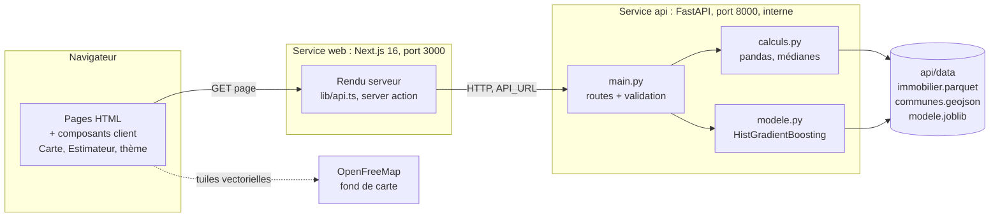
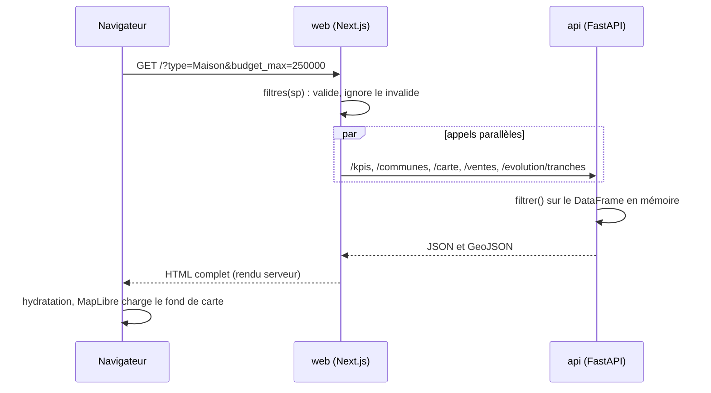

# Architecture

## Vue d'ensemble

L'application a deux services Docker et aucune base de données : l'API lit un fichier Parquet au démarrage, le front interroge l'API côté serveur.

| Élément | Rôle | Fichiers |
|---|---|---|
| **API** | Valide les filtres, calcule des médianes avec pandas, sert du JSON et du GeoJSON, estime un prix | `api/main.py`, `api/calculs.py`, `api/modele.py` |
| **Front** | Rend les pages côté serveur avec les données préchargées, garde l'état de la recherche dans l'URL | `web/app/**`, `web/lib/api.ts` |
| **Préparation des données** | Télécharge DVF, filtre, écrit le Parquet (hors ligne, à la main) | `api/prepare.py` |
| **Données** | Ventes, contours des communes, modèle entraîné | `api/data/` |
| **Déploiement** | Deux images Docker, un `docker-compose.yml`, Dokploy en production | `api/Dockerfile`, `web/Dockerfile`, `docker-compose*.yml` |

## Pourquoi deux services

Le choix est fait pour séparer **les calculs** (pandas, scikit-learn) **de l'affichage**, et pour offrir une API réutilisable : une autre application, un notebook ou un outil de BI peut appeler les mêmes routes. Le front ne contient aucun calcul sur les ventes : il met en forme ce que l'API renvoie.

## Flux d'une visite

1. Le navigateur demande une page. Les filtres sont dans l'URL (`?type=…&budget_max=…`).
2. Le serveur Next.js les valide dans `filtres()` (`web/lib/api.ts`) : toute valeur hors bornes est ignorée, jamais renvoyée en erreur.
3. Il appelle l'API en parallèle (`Promise.all`). Les réponses sont mises en cache une heure (`revalidate: 3600`).
4. L'API applique la même validation avec ses propres bornes (dépendance `filtres` de `main.py`) puis filtre le DataFrame et agrège.
5. La page arrive complète, y compris sur téléphone. Seuls la carte (MapLibre), l'estimateur, le bouton de thème et la page d'erreur sont des composants client ; le graphique d'évolution est un SVG rendu côté serveur.

La page `/estimer` fait exception : le formulaire appelle une **server action** (`web/app/estimer/actions.ts`) qui interroge `/estimation` sans cache (`cache: "no-store"`).

## Données en mémoire

| Objet | Chargé | Taille | Mécanisme |
|---|---|---|---|
| `immobilier.parquet` | au premier appel | 1,7 Mo sur disque, 46 022 lignes × 18 colonnes | `calculs.charger()` avec `@lru_cache` |
| `communes.geojson` | au premier appel | 436 Ko, 325 polygones | `calculs.contours()` avec `@lru_cache` |
| `modele.joblib` | au premier appel de `/estimation` | 380 Ko | `main.charger_modele()` avec `@lru_cache` |

L'API ne garde aucun état entre deux requêtes en dehors de ces caches. Elle peut donc être dupliquée sans coordination, et n'a rien à sauvegarder.

Chaque requête filtre le DataFrame complet puis agrège. Mesuré en local, cache chaud, sans réseau : `/kpis` 8 ms, `/communes` 16 ms, `/evolution/tranches` 31 ms, `/estimation` 46 ms, `/carte` 69 ms, `/ventes` (3 000 points) 90 ms. Le cache du front évite de répéter ces calculs pendant une heure.

## Modèle d'estimation

`modele.py` entraîne un `HistGradientBoostingRegressor` sur `log1p(valeur_fonciere)`. Le détail (variables, encodage, métriques, limites) est dans [donnees.md](donnees.md#modèle-destimation). Le modèle est entraîné **au build Docker** (`RUN python modele.py`) et jamais à chaque requête. Si `modele.joblib` est absent au démarrage, l'API l'entraîne une fois (environ 10 secondes) puis le garde.

## Choix de conception

| Choix | Raison |
|---|---|
| **Médianes, jamais de moyennes** | Quelques ventes extrêmes déforment une moyenne ; la médiane représente mieux le marché |
| **Une seule dépendance `filtres` pour toutes les routes** | Un filtre appliqué à la carte l'est aussi aux indicateurs, au graphique et aux ventes : la page ne se contredit pas |
| **`null` quand une médiane porte sur 0 vente** | Un `NaN` pandas n'est pas du JSON valide ; le front affiche « n/d » |
| **L'URL porte l'état** | Les formulaires sont de simples `GET` : la recherche se partage, se met en favori et fonctionne sans JavaScript |
| **Pas de 3D, pas de plan de maison** | Décision de l'équipe le 20 novembre : une carte 2D soignée plutôt qu'un effet |
| **Fond de carte OpenFreeMap + MapLibre GL** | Pas de clé d'API, pas de quota |
| **Rendu serveur** | La page est complète dès la première visite, utile sur téléphone et pour l'accessibilité |
| **Modèle entraîné au build** | Une requête ne doit jamais attendre un entraînement |
| **Ni compte ni cookie de suivi** | L'application ne collecte rien sur le ménage ; seule la préférence de thème est gardée dans le navigateur (`localStorage`) |

## Limites connues

| Limite | Effet | Où agir |
|---|---|---|
| **DVF ne dit pas l'état du bien, l'étage, le DPE, la piscine** | L'estimation a une fourchette large (MAPE 28,5 %) | [Base enrichie](base-enrichie.md) |
| **Les années 2021 à 2025 sont écrites en dur** | Ajouter 2026 demande de modifier `main.py` (`le=2025`), `web/lib/api.ts` (`ANNEES`), les filtres et les tests | `api/main.py`, `web/lib/api.ts` |
| **L'estimation fixe l'année à 2025 et le terrain à la médiane de la commune et du type** | Le contrat de la route ne demande pas la surface du terrain | `api/main.py` (`estimation`) |
| **Une vente = un seul logement** | Les ventes de plusieurs logements, qui partagent un prix unique, sont écartées | `api/prepare.py` |
| **Les communes de moins de 5 ventes sont hachurées sur la carte** | Une médiane sur 4 ventes ne dit rien du marché | `web/app/Carte.tsx` |
| **Aucune authentification, CORS ouvert en `GET`** | Acceptable car l'API est interne au Compose et ne sert que des données publiques | `api/main.py` |
| **Pas d'intégration continue dans le dépôt** | Les tests et le lint sont lancés à la main | [developpement.md](developpement.md) |
| **`modele.joblib` n'est pas versionné** | Chaque build ré-entraîne le modèle : les métriques peuvent varier si la bibliothèque change | `api/.gitignore` |
| **L'en-tête `x-total-count` n'est pas envoyé par l'API** | Le front le prévoit en secours, mais le total est dans le corps de `/ventes` (champ `total`) | `api/calculs.py`, `web/lib/api.ts` |
