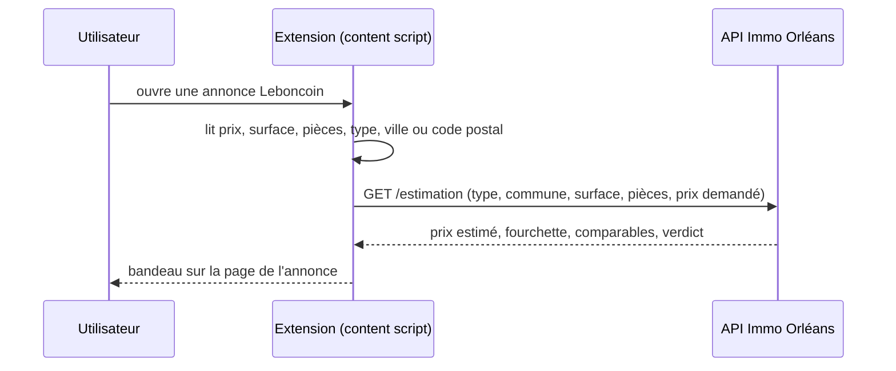

# Extension Chrome : analyser une annonce Leboncoin

> **Statut : piste d'évolution, non implémentée.** Ce document cadre une fonctionnalité future. Aucun code d'extension n'existe dans le dépôt, et aucune extension n'est publiée sur le Chrome Web Store. La publication demande une validation par Google, qui prend en général plusieurs jours : elle ne peut pas être faite pour la démonstration.

## L'idée

Le couple qui cherche à acheter passe l'essentiel de son temps sur les sites d'annonces. Notre site répond à « dans quelle commune chercher, pour quel budget » ; l'extension apporterait **la même réponse directement sur l'annonce** : en ouvrant une annonce Leboncoin, un bandeau dit si le prix demandé est **au-dessus, dans la fourchette ou au-dessous** de ce que les ventes réelles du Loiret laissent attendre pour ce bien, et affiche les prix médians de la commune.

C'est exactement ce que fait déjà la page `/estimer` du site (verdict `au-dessus`, `dans la fourchette`, `au-dessous`), mais sans ressaisir l'annonce à la main.

## Ce que verrait l'utilisateur

```text
┌─ Annonce Leboncoin : Maison 5 pièces, 100 m², Orléans, 300 000 € ───────┐
│                                                                          │
│  ┌─ Immo Orléans ────────────────────────────────────────────────────┐   │
│  │ ▲ Au-dessus de la fourchette                                      │   │
│  │ Estimation : 226 000 €   (fourchette 184 000 à 268 000 €)         │   │
│  │ Prix demandé : 3 000 €/m²  ·  médiane d'Orléans : 2 614 €/m²     │   │
│  │ 1 024 ventes comparables dans la commune                          │   │
│  │ [Voir la commune sur la carte]  [Affiner l'estimation]            │   │
│  └───────────────────────────────────────────────────────────────────┘   │
└──────────────────────────────────────────────────────────────────────────┘
```

(Maquette. Les chiffres reprennent un vrai appel à `/estimation` de l'API sur une maison de 100 m², 5 pièces, avec jardin, à Orléans : 226 000 € estimés, fourchette de 184 000 à 268 000 €.)

## Fonctionnement



1. **Un script de contenu** s'exécute sur les pages d'annonces (`leboncoin.fr`) que l'utilisateur ouvre lui-même. Il lit ce que la page affiche déjà : prix, surface, nombre de pièces, type de bien, localisation.
2. Il retrouve **le code INSEE de la commune** à partir de la ville ou du code postal.
3. Il appelle **l'API existante**, route `/estimation`, qui répond déjà avec ce dont le bandeau a besoin : `prix_estime`, `fourchette_basse`, `fourchette_haute`, `comparables` et `verdict` ([api.md](api.md#get-estimation)).
4. Il affiche le bandeau.

## Ce qui existe déjà, et ce qu'il faudrait ajouter

| Besoin | État |
|---|---|
| Estimation d'un prix et verdict par rapport au prix demandé | **Existe** : `GET /estimation` |
| Prix médians d'une commune | **Existe** : `GET /communes/{code}` |
| Lien vers la commune ou l'estimateur du site | **Existe** : pages `/commune/[code]` et `/estimer` |
| API accessible depuis un navigateur tiers | **À faire** : l'API n'est aujourd'hui pas exposée (interne au Compose) ; il faudrait la publier, restreindre l'origine, limiter le débit |
| Trouver le code commune depuis un code postal ou un nom de ville | **À faire** : une petite route de recherche (la colonne `code_postal` est dans les données) |
| Lecture fiable de l'annonce | **À faire** : l'extension, sa lecture de la page, ses tests |
| Couverture hors Loiret | **Hors périmètre** : les données ne couvrent que le Loiret ; l'extension doit dire « hors zone » ailleurs |

## Ce que cela apporte

- **Le moment où la décision se prend.** L'avis arrive pendant la lecture de l'annonce, pas après un détour par un autre site.
- **Une aide fondée sur des ventes réelles**, pas sur d'autres annonces : les prix de DVF sont ceux des ventes conclues.
- **La valeur du site se généralise** : la carte et les médianes éclairent le choix de la commune, l'extension éclaire le choix du bien.
- **Un levier de diffusion** : chaque annonce analysée renvoie vers la commune sur le site.
- **La personnalisation y trouve sa place** : le profil du couple (enfants, sport, emploi) du [catalogue de données](personnalisation-datagouv.md) pourrait s'afficher aussi sur l'annonce (écoles proches, couverture petite enfance, fibre).
- **La base enrichie** ([base-enrichie.md](base-enrichie.md)) permettrait d'affiner l'estimation avec ce que l'annonce indique et que DVF ignore : l'étiquette DPE, l'année de construction, la piscine.

## Limites à annoncer honnêtement

| Limite | Conséquence |
|---|---|
| **Prix demandé et prix de vente ne sont pas la même chose** | Un bien affiché au prix des ventes passées peut être normal : la marge de négociation n'est pas connue |
| **Le modèle se trompe de 28,5 % en moyenne** (MAPE), 41 881 € en valeur absolue | Le verdict est une **indication**, jamais une décision ; la fourchette est large ([donnees.md](donnees.md#modèle-destimation)) |
| **Le modèle ignore l'état, l'étage, le DPE, la piscine, l'exposition** | Un bien rénové et un bien à rénover reçoivent la même estimation |
| **Le Loiret seulement** | Aucun verdict ailleurs |
| **Une annonce peut être incomplète** | Surface ou pièces manquantes : l'extension demande à les saisir au lieu de deviner |
| **La page Leboncoin peut changer** | La lecture de l'annonce est la partie fragile : elle demande de la maintenance |

## Cadre juridique et vie privée

À traiter **avant** tout développement, car ce sont les vrais obstacles :

- **Conditions d'utilisation de Leboncoin.** Elles encadrent la collecte automatisée de leurs contenus. L'extension doit **lire uniquement la page que l'utilisateur consulte**, sans la stocker, sans parcourir le site à sa place, et sans republier le contenu. Les conditions en vigueur sont à relire et à faire valider.
- **Aucune donnée personnelle envoyée.** Seules les caractéristiques du bien (type, commune, surface, pièces, prix demandé) partiraient vers l'API : jamais l'adresse précise, l'identité du vendeur, le texte de l'annonce, l'URL, ni l'identité de l'utilisateur.
- **Pas de compte, pas de suivi**, comme le site aujourd'hui.
- **Permissions minimales** : l'extension ne demanderait que l'accès aux pages d'annonces de Leboncoin et à notre API, rien d'autre. C'est aussi ce que Google examine lors de la validation.
- **Marque** : ne pas laisser croire à un partenariat ou à un produit de Leboncoin.

## Publication

| Étape | Détail |
|---|---|
| **Format** | Extension Chrome en Manifest V3 (script de contenu et fenêtre d'options) |
| **Validation Google** | La publication sur le Chrome Web Store passe par une revue ; comptez de un à trois jours, parfois plus. Elle ne peut pas être raccourcie |
| **Avant la publication** | Une extension peut être chargée localement en mode développeur pour les tests et les démonstrations internes, sans passer par le Store |
| **Déclarations** | Politique de confidentialité, justification de chaque permission |
| **Autres navigateurs** | Le même code se porte sur Edge et Firefox avec peu d'adaptations |

## Feuille de route proposée

| Étape | Contenu | Résultat |
|---|---|---|
| **0. Cadrage** | Valider les conditions de Leboncoin, décider du périmètre | Feu vert juridique |
| **1. API publique** | Exposer l'API en lecture, CORS restreint, limitation de débit, route de recherche de commune | Le site et l'extension partagent la même API |
| **2. Prototype** | Script de contenu qui lit une annonce et affiche le verdict | Démonstration sur des annonces du Loiret |
| **3. Version bêta** | Saisie des champs manquants, message « hors zone », options, tests sur des annonces réelles | Utilisable par des testeurs, en mode développeur |
| **4. Publication** | Soumission au Chrome Web Store, politique de confidentialité | Disponible après validation |
| **5. Enrichissements** | DPE et année de construction lus dans l'annonce, indicateurs du profil du couple, autres sites d'annonces | Valeur ajoutée au-delà du prix |

## Pour la démonstration

À dire simplement : l'extension **n'existe pas encore** ; le site expose déjà tout ce qu'elle appellerait (route `/estimation` et son verdict) ; le travail restant est l'extension elle-même, l'ouverture de l'API et la validation juridique et technique ; et la publication demande plusieurs jours de revue Google, d'où une présentation sous forme de piste d'évolution.
