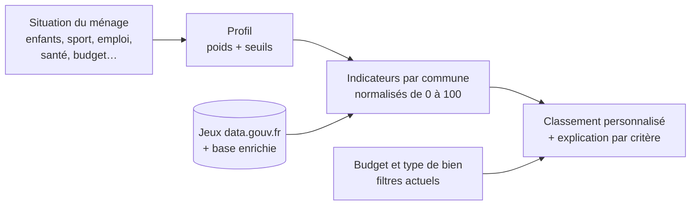

# Personnaliser le résultat selon la situation du couple

Aujourd'hui, l'application classe les communes par **prix**. Or la bonne commune pour un couple sans enfant qui télétravaille n'est pas la bonne commune pour une famille avec deux enfants à la crèche, pour quelqu'un qui cherche un emploi, ou pour un sportif qui veut un bassin et un club à dix minutes. Ce document recense **les données ouvertes, sur data.gouv.fr surtout, qui permettent de tenir compte de la situation du ménage**, dit comment les rattacher au projet et propose une méthode de score.

C'est un document de cadrage : **rien de ce qui suit n'est implémenté**. Il sert à décider quoi intégrer en premier.

## Ce qui est vérifié

Chaque jeu de données de cette page a été **retrouvé sur l'API data.gouv.fr le 20 novembre 2026** : le titre, le producteur, la licence, la date de mise à jour et le lien viennent de cette API, pas de la mémoire. Les mailles (commune, IRIS, point…) viennent des titres et des descriptions des fiches ; quand une fiche ne le dit pas, la colonne le dit. Ces jeux **n'ont pas été téléchargés ni exploités** : la valeur d'un indicateur et la qualité d'une colonne restent à contrôler au moment de l'intégration.

## 1. Principe



Le prix reste la contrainte (le budget et les filtres actuels ne changent pas). La personnalisation ajoute **un deuxième classement** : parmi les communes où l'on peut acheter, lesquelles conviennent le mieux à cette situation, et pourquoi.

## 2. Comment rattacher une donnée au projet

La clé de tout le projet est le **code INSEE de la commune** (`code_commune`, 5 caractères). Les jeux se rattachent selon leur maille :

| Maille | Clé de jointure | Ce qu'il faut faire | Exemples |
|---|---|---|---|
| **Commune** | `code_commune` | Jointure directe sur le code INSEE (attention au millésime du COG) | CNAF communal, APL, REI, délinquance, ATMO, loyers |
| **IRIS** | code IRIS (9 caractères) | Il faut les contours IRIS pour y placer une vente (jointure spatiale) ; sinon agréger à la commune | Insee famille, ménages, emploi |
| **Carreau de 200 m** | identifiant de carreau | Déjà fait pour Filosofi 2019 dans la base enrichie | Revenus carroyés |
| **Point** (latitude, longitude) | position de la vente | Compter ou mesurer la distance, comme la base enrichie le fait pour la BPE (rayon de 1 km en Lambert-93) | Équipements sportifs, gares, IRVE, covoiturage, associations |
| **Établissement** (UAI, FINESS, SIRET) | identifiant et adresse | Géocoder si besoin, puis traiter comme un point | Écoles, hôpitaux, entreprises |
| **Tracé ou polygone** | géométrie | Distance au tracé, ou appartenance du point au polygone | Randonnées, pistes cyclables, ZNIEFF, périmètres PPRI |
| **Station, grille** | station la plus proche, maille | Rattacher chaque commune à sa station ou sa maille | Météo, projections climatiques |
| **Série** (pas de maille fine) | aucune | Sert de contexte (département, région), pas de classement entre communes | France Travail |

**Le piège du COG :** les communes fusionnent. Un jeu publié avec le COG de l'année N peut contenir des codes absents des 325 communes du fichier de contours, ou l'inverse. Le jeu [Code officiel géographique](https://www.data.gouv.fr/datasets/code-officiel-geographique-1) de l'Insee donne les correspondances.

## 3. Situation du couple : quoi regarder

| Situation | Questions que le couple se pose | Indicateurs clés | Section |
|---|---|---|---|
| **Enfants de moins de 3 ans, ou projet de bébé** | Aurons-nous une place en crèche ou chez une assistante maternelle ? Une maternité est-elle proche ? | Taux de couverture d'accueil, places, assistantes maternelles, maternités, pédiatres | [A](#a-famille-et-enfants) |
| **Enfants scolarisés** | Quelle école, quel collège, avec quelle mixité sociale et quels résultats ? | Distance à l'école, IPS, réussite au brevet, carte scolaire | [A](#a-famille-et-enfants) |
| **Famille nombreuse** | Aurons-nous la place, et le budget ? | Taille des ménages, surface et pièces (DVF), taxe foncière | [A](#a-famille-et-enfants), [F](#f-budget-énergie-et-aides) |
| **Pratique d'un sport** | Y a-t-il le bon équipement et un club à proximité ? | Équipements par activité, licences, clubs, pistes cyclables, sentiers | [B](#b-sport-loisirs-et-culture) |
| **Vie culturelle et associative** | Bibliothèque, cinéma, associations, événements ? | Lieux culturels, associations, agenda | [B](#b-sport-loisirs-et-culture) |
| **Recherche d'emploi ou changement de poste** | Y a-t-il un bassin d'emploi, des employeurs, des formations ? | Emplois sur place, établissements Sirene, chômage, formations | [C](#c-emploi-et-activité) |
| **Navetteurs** | Quel temps de trajet, quelle gare, quel covoiturage ? | Gares, TER, bus, covoiturage, trafic routier, mode de déplacement des actifs | [D](#d-mobilité-et-télétravail) |
| **Télétravail** | La fibre est-elle disponible, l'endroit est-il calme ? | Fibre, bruit, transports occasionnels | [D](#d-mobilité-et-télétravail) |
| **Véhicule électrique, vélo** | Où recharger, où rouler ? | Bornes de recharge, aménagements cyclables | [D](#d-mobilité-et-télétravail) |
| **Santé, grossesse, maladie chronique** | Un médecin, un spécialiste, un hôpital près de chez nous ? | APL, spécialistes, établissements | [E](#e-santé-seniors-et-accessibilité) |
| **Retraités ou projet de retraite** | Soins, commerces, EHPAD plus tard, vie sociale ? | Part des 65 ans et plus, APL, EHPAD, accessibilité | [E](#e-santé-seniors-et-accessibilité) |
| **Mobilité réduite ou handicap** | Les lieux et les gares sont-ils accessibles ? | Accessibilité des établissements, des gares | [E](#e-santé-seniors-et-accessibilité) |
| **Premier achat, budget serré** | Combien coûte vraiment le logement chaque année ? Quelles aides ? | Taxe foncière, DPE, zonage ABC, loyers pour comparer | [F](#f-budget-énergie-et-aides) |
| **Investissement locatif** | Quel loyer, quelle vacance, quelle demande ? | Loyers 2025, logements vacants, étudiants, démographie | [F](#f-budget-énergie-et-aides), [I](#i-étudiants-et-colocataires) |
| **Sécurité, tranquillité** | La commune est-elle sûre, calme ? | Délinquance enregistrée, bruit, trafic | [G](#g-sécurité-et-tranquillité) |
| **Climat, air, nature** | Chaleur, air, eau, nature ? | Climatologie, projections, qualité de l'air, eau, ZNIEFF | [H](#h-climat-air-eau-et-nature) |
| **Colocation, études** | Formations, loyers T1-T2, transports ? | Parcoursup, insertion, loyers, bus | [I](#i-étudiants-et-colocataires) |
| **Vie quotidienne** | Commerces, marchés, services ? | BPE (déjà), Sirene, marchés | [J](#j-vie-quotidienne-et-commerces) |

## 4. Catalogue par thème

Dans chaque section : ce que **la base enrichie permet déjà**, puis les **jeux à ajouter**, les **indicateurs proposés** et les **points de vigilance**.

### A. Famille et enfants

**Déjà dans la base enrichie :** `nb_ecoles_1km`, `dist_ecole_proche_m`, `nb_colleges_lycees_1km` (par vente) ; `bpe_nb_c` (enseignement) et `bpe_nb_d` (santé, action sociale) par commune ; `nb_medecins_generalistes_1km`, `nb_pharmacies_1km` ; `part_menages_pauvres_carreau`, `nb_habitants_carreau`. Il manque : la **petite enfance**, la **qualité et la mixité des écoles**, le **nombre de familles avec enfants** et les **aires de jeux**.

**À ajouter :**

| Jeu de données | Producteur · licence · mise à jour | Maille | Ce qu'on en tire |
|---|---|---|---|
| [Taux de couverture d'accueil du jeune enfant (Communal)](https://www.data.gouv.fr/datasets/taux-de-couverture-daccueil-du-jeune-enfant-communal) | CNAF · Licence Ouverte 2.0 · 2026-01-22 | Commune | Taux de couverture de l'accueil des moins de 3 ans (la définition exacte est dans la fiche) : y aura-t-il une place ? |
| [Nombre de places offertes pour les enfants de moins de 3 ans (Communal)](https://www.data.gouv.fr/datasets/nombre-de-places-offertes-pour-les-enfants-de-moins-de-3-ans-communal) | CNAF · Licence Ouverte 2.0 · 2026-01-22 | Commune | Nombre de places d'accueil offertes aux enfants de moins de 3 ans |
| [Nombre de particuliers employeurs d'assistantes maternelles et d'autres salariés](https://www.data.gouv.fr/datasets/nombre-de-particuliers-employeurs-dassistantes-maternelles-et-dautres-salaries) | Insee · Licence Ouverte 2.0 · 2026-11-13 | Commune, bassin de vie, département (selon la fiche) | Recours aux assistantes maternelles : indique l'offre de garde individuelle |
| [CMG - Répartition des allocataires selon le type de CMG et la situation familiale (Communal)](https://www.data.gouv.fr/datasets/cmg-repartition-des-allocataires-selon-le-type-de-cmg-et-la-situation-familiale-communal) | CNAF · Licence Ouverte 2.0 · 2026-02-11 | Commune (aussi IRIS) | Familles qui perçoivent le complément de libre choix du mode de garde |
| [AF - Répartition des allocataires selon le type d'AF (Communal)](https://www.data.gouv.fr/datasets/af-repartition-des-allocataires-selon-le-type-daf-communal) | CNAF · Licence Ouverte 2.0 · 2026-02-11 | Commune (aussi IRIS) | Familles allocataires d'allocations familiales : mesure la présence de familles avec enfants |
| [Famille – Principaux indicateurs (dossier complet)](https://www.data.gouv.fr/datasets/famille-principaux-indicateurs-dossier-complet) | Insee · Licence Ouverte 2.0 · 2026-10-09 | Commune (aussi arrondissements, EPCI…) | Nombre de familles selon le type et le nombre d'enfants, familles recomposées |
| [Famille - Principaux indicateurs - Iris](https://www.data.gouv.fr/datasets/famille-principaux-indicateurs-iris) | Insee · Licence Ouverte 2.0 · 2026-10-16 | IRIS | La même chose à l'échelle du quartier |
| [Ménages selon la taille du ménage – Données détaillées (MEN4)](https://www.data.gouv.fr/datasets/menages-selon-la-taille-du-menage-donnees-detaillees-men4) | Insee · Licence Ouverte 2.0 · 2026-10-09 | Commune (données détaillées) | Répartition des ménages par taille : repère les communes de familles nombreuses |
| [Nombre de naissances annuelles par commune](https://www.data.gouv.fr/datasets/nombre-de-naissances-annuelles-par-commune) | Insee · Licence Ouverte 2.0 · 2026-06-02 | Commune | Natalité : une commune qui accueille des bébés a des services pour eux |
| [Annuaire de l'éducation](https://www.data.gouv.fr/datasets/annuaire-de-leducation) | Éducation nationale · Licence Ouverte 2.0 · 2026-11-19 | Établissement (géolocalisé) | Écoles, collèges, lycées publics et privés ouverts : type, statut, position |
| [Indices de position sociale des écoles (à partir de 2022)](https://www.data.gouv.fr/datasets/indices-de-position-sociale-dans-les-ecoles-a-partir-de-2022) | Éducation nationale · Licence Ouverte 2.0 · 2026-08-07 | Établissement | IPS des écoles : mixité sociale de l'école la plus proche |
| [Indices de position sociale des collèges (à partir de 2023)](https://www.data.gouv.fr/datasets/ips-colleges-a-partir-de-2023) | Éducation nationale · non précisée · 2026-09-01 | Établissement | IPS des collèges |
| [Indices de position sociale des lycées (à partir de 2023)](https://www.data.gouv.fr/datasets/ips-lycees-a-partir-de-2023) | Éducation nationale · non précisée · 2026-06-10 | Établissement | IPS des lycées |
| [Diplôme national du brevet par établissement](https://www.data.gouv.fr/datasets/diplome-national-du-brevet-par-etablissement-1) | Éducation nationale · Licence Ouverte 2.0 · 2026-09-23 | Établissement | Taux de réussite et mentions au brevet, par collège |
| [Carte scolaire des écoles maternelles - Ville d'Orléans](https://www.data.gouv.fr/datasets/carte-scolaire-des-ecoles-maternelles-ville-dorleans) | Orléans Métropole · Licence Ouverte 2.0 · 2026-03-21 | Orléans (ville) | Secteur scolaire : quelle école maternelle dessert l'adresse |
| [Carte scolaire des écoles élémentaires - Ville d'Orléans](https://www.data.gouv.fr/datasets/carte-scolaire-des-ecoles-elementaires-ville-dorleans) | Orléans Métropole · Licence Ouverte 2.0 · 2026-03-21 | Orléans (ville) | Secteur scolaire : quelle école élémentaire dessert l'adresse |
| [Annuaire des établissements scolaires - Orléans Métropole](https://www.data.gouv.fr/datasets/annuaire-des-etablissements-scolaires-orleans-metropole) | Orléans Métropole · Licence Ouverte 2.0 · 2026-10-01 | Orléans Métropole | Établissements scolaires de la métropole |
| [Collèges publics et privés - Département du Loiret](https://www.data.gouv.fr/datasets/localisation-des-colleges-1) | Département du Loiret · non précisée · 2024-02-20 | Loiret | Collèges publics et privés du département |
| [Aires de jeux et aires sportives - Orléans Métropole](https://www.data.gouv.fr/datasets/aires-de-jeux-et-aires-sportives-orleans-metropole-1) | Orléans Métropole · Licence Ouverte 2.0 · 2026-11-14 | Orléans Métropole | Aires de jeux pour enfants et aires sportives de proximité |
| [Éducation - Scolarisation – Principaux indicateurs (dossier complet)](https://www.data.gouv.fr/datasets/education-scolarisation-principaux-indicateurs-dossier-complet) | Insee · Licence Ouverte 2.0 · 2026-10-09 | Commune | Part des enfants et des jeunes scolarisés par âge |

**Indicateurs proposés :**

- `couverture_petite_enfance` : taux de couverture communal (plus haut = mieux) ;
- `distance_ecole` : `dist_ecole_proche_m` déjà présent (plus bas = mieux), et `ips_ecole_proche` : IPS de l'école la plus proche ;
- `reussite_college` : taux de réussite au brevet du collège le plus proche ;
- `part_familles_avec_enfants` : part des familles avec enfants dans la commune (indique si la vie y est adaptée) ;
- `maternite_proche` : distance à la maternité la plus proche (voir E).

**Vigilance :** l'IPS mesure le **profil social** des élèves, pas la qualité de l'enseignement ; le présenter comme un indicateur de mixité, jamais comme une note. Un secteur scolaire peut changer chaque année ; le vérifier auprès de la mairie. La carte scolaire n'existe ici que pour Orléans.

### B. Sport, loisirs et culture

**Déjà dans la base enrichie :** seulement `bpe_nb_f` (équipements de sports, loisirs et culture, tous confondus, par commune) et `bpe_nb_g` (tourisme). On ne sait pas **quel** sport est praticable ni **à quelle distance** : c'est le plus gros manque pour un sportif.

**À ajouter :**

| Jeu de données | Producteur · licence · mise à jour | Maille | Ce qu'on en tire |
|---|---|---|---|
| [Recensement des équipements sportifs, espaces et sites de pratiques](https://www.data.gouv.fr/datasets/recensement-des-equipements-sportifs-espaces-et-sites-de-pratiques) | Ministère chargé des Sports · Licence Ouverte 2.0 · 2026-11-20 | Équipement (point) | Équipements et lieux de pratique : piscines, gymnases, courts, stades, bassins… avec leur position |
| [Data ES - Recensement des équipements sportifs et lieux de pratique (Complet)](https://www.data.gouv.fr/datasets/data-es-recensement-des-equipements-sportifs-et-lieux-de-pratique-complet-1) | Ministère chargé des Sports · Licence Ouverte 2.0 · 2026-11-18 | Équipement (point) | Version complète de Data ES, avec les activités pratiquées |
| [Référentiel d’activités physiques et sportives](https://www.data.gouv.fr/datasets/referentiel-dactivites-physiques-et-sportives) | Ministère chargé des Sports · Licence Ouverte 2.0 · 2026-02-17 | Nomenclature | Table de correspondance des activités (pour que le couple choisisse « mon sport » dans une liste) |
| [Données géocodées issues du recensement des licences et clubs auprès des fédérations sportives agréées par le ministère chargé des sports](https://www.data.gouv.fr/datasets/donnees-geocodees-issues-du-recensement-des-licences-et-clubs-aupres-des-federations-sportives-agreees-par-le-ministere-charge-des-sports) | INJEP · Licence Ouverte 1.0 · 2025-12-29 | Commune | Licences et clubs par fédération sportive : y a-t-il un club de mon sport ? |
| [Répertoire National des Associations](https://www.data.gouv.fr/datasets/repertoire-national-des-associations) | Ministère de l'Intérieur · Licence Ouverte 1.0 · 2026-09-30 | Association (siège) | Clubs et associations par objet : sport, culture, loisirs, entraide |
| [Annuaire des associations - Orléans](https://www.data.gouv.fr/datasets/annuaire-des-associations-orleans) | Orléans Métropole · Licence Ouverte 2.0 · 2026-11-20 | Orléans | Annuaire local des associations |
| [Offre d'activités des associations (lieux et horaires) - Orléans Métropole](https://www.data.gouv.fr/datasets/offre-dactivites-des-associations-lieux-et-horaires-orleans-metropole) | Orléans Métropole · Licence Ouverte 2.0 · 2026-11-19 | Orléans Métropole | Activités des associations, avec lieux et horaires |
| [Sport, loisirs et culture : dénombrement, caractéristiques et capacités des équipements](https://www.data.gouv.fr/datasets/sport-loisirs-et-culture-denombrement-caracteristiques-et-capacites-des-equipements) | Insee · Licence Ouverte 2.0 · 2026-11-16 | Voir la fiche (communal ou plus fin) | Dénombrement des équipements de sport, loisirs et culture (BPE Insee) |
| [Itinéraires de petites randonnées du PDIPR - Département du Loiret](https://www.data.gouv.fr/datasets/itineraires-de-petites-randonnees-du-pdipr-departement-du-loiret-1) | Département du Loiret · Licence Ouverte 2.0 · 2024-11-13 | Tracé | Sentiers de randonnée du département : marche, trail, course à pied |
| [Cyclotourisme - Véloroutes](https://www.data.gouv.fr/datasets/cyclotourisme-veloroutes) | Région Centre-Val de Loire · Licence Ouverte 2.0 · 2026-10-19 | Tracé | Véloroutes du Centre-Val de Loire : vélo loisir |
| [Aménagements cyclables France Métropolitaine](https://www.data.gouv.fr/datasets/amenagements-cyclables-france-metropolitaine) | Geovelo · ODbL · 2026-11-03 | Tracé | Pistes et bandes cyclables : vélo du quotidien et vélo sportif |
| [Aménagements cyclables - Orléans Métropole](https://www.data.gouv.fr/datasets/amenagements-cyclables-orleans-metropole-1) | Orléans Métropole · Licence Ouverte 2.0 · 2026-11-14 | Orléans Métropole | Aménagements cyclables de la métropole (plus détaillé) |
| [Base des lieux culturels ouverts](https://www.data.gouv.fr/datasets/base-des-lieux-culturels-ouverts) | Ministère de la Culture · Licence Ouverte 2.0 · 2026-11-19 | Lieu (point) | Lieux culturels ouverts : cinémas, théâtres, musées… |
| [Les bibliothèques des collectivités territoriales : adresses et données d’activité](https://www.data.gouv.fr/datasets/adresses-des-bibliotheques-publiques-2) | Ministère de la Culture · Licence Ouverte 2.0 · 2026-08-18 | Bibliothèque (adresse, géocodée) | Bibliothèques et médiathèques |
| [Fréquentation des Musées de France](https://www.data.gouv.fr/datasets/frequentation-des-musees-de-france-1) | Ministère de la Culture · Licence Ouverte 1.0 · 2026-11-16 | Musée | Fréquentation des musées : repère l'attractivité |
| [Evénements dans le territoire du Loiret (OpenAgenda du Loiret)](https://www.data.gouv.fr/datasets/evenements-dans-le-territoire-du-loiret-openagenda-du-loiret) | Département du Loiret · Licence Ouverte 1.0 · 2026-11-20 | Événement | Agenda culturel et festif du Loiret |
| [INPN - Données du programme ZNIEFF](https://www.data.gouv.fr/datasets/inpn-donnees-du-programme-znieff) | MNHN (INPN) · Licence Ouverte 1.0 · 2026-11-20 | Polygone | Zones naturelles d'intérêt écologique : espaces de nature à proximité |

**Indicateurs proposés :**

- `equipement_sport_proche` : distance à l'équipement du sport choisi (le couple le choisit dans le référentiel d'activités) ;
- `nb_equipements_sport_2km` : nombre d'équipements dans un rayon de 2 km, calculé comme la base enrichie calcule la BPE ;
- `clubs_du_sport` : nombre de clubs ou de licences du sport choisi dans la commune ;
- `velo_quotidien` : longueur d'aménagements cyclables dans un rayon de 1 km ;
- `nature_proche` : distance à la zone naturelle ou au sentier le plus proche.

**Vigilance :** les licences et les équipements dépendent du **recensement** : un équipement manquant dans le recensement n'est pas un équipement absent. Vérifier dans la fiche si les licences sont rattachées à la commune du club ou à celle du licencié.

### C. Emploi et activité

**Déjà dans la base enrichie :** rien sur l'emploi. Les seules données de revenu sont Filosofi (`filosofi_*`, niveau de vie, 317 communes sur 325) ; `bpe_nb_e` et `nb_gares_1km` donnent une idée de la desserte. Pour quelqu'un qui **cherche un emploi** ou veut en changer, il manque le **bassin d'emploi** autour de la commune.

**À ajouter :**

| Jeu de données | Producteur · licence · mise à jour | Maille | Ce qu'on en tire |
|---|---|---|---|
| [Population active et chômage - Principaux indicateurs (dossier complet)](https://www.data.gouv.fr/datasets/population-active-et-chomage-principaux-indicateurs-dossier-complet-1) | Insee · Licence Ouverte 2.0 · 2026-10-09 | Commune (aussi IRIS) | Population active, taux d'activité et de chômage au recensement |
| [Emploi au lieu de travail - Principaux indicateurs (dossier complet)](https://www.data.gouv.fr/datasets/emploi-au-lieu-de-travail-principaux-indicateurs-dossier-complet-1) | Insee · Licence Ouverte 2.0 · 2026-10-09 | Commune | Nombre d'emplois situés dans la commune : repère les pôles d'emploi |
| [Déplacements domicile-travail - Principaux indicateurs (dossier complet)](https://www.data.gouv.fr/datasets/deplacements-domicile-travail-principaux-indicateurs-dossier-complet) | Insee · Licence Ouverte 2.0 · 2026-10-09 | Commune (aussi IRIS) | Où travaillent les actifs et comment ils s'y rendent |
| [Estimation des émissions individuelles de gaz à effet de serre lors des déplacements domicile-travail](https://www.data.gouv.fr/datasets/estimation-des-emissions-individuelles-de-gaz-a-effet-de-serre-lors-des-deplacements-domicile-travail) | Insee · Licence Ouverte 2.0 · 2025-12-19 | Commune | Émissions de gaz à effet de serre des trajets domicile-travail : repère les communes dépendantes de la voiture |
| [Base Sirene des entreprises et de leurs établissements (SIREN, SIRET)](https://www.data.gouv.fr/datasets/base-sirene-des-entreprises-et-de-leurs-etablissements-siren-siret) | Insee · Licence Ouverte 2.0 · 2026-11-05 | Établissement (SIRET) | Employeurs par secteur (NAF) et taille : combien d'entreprises de mon secteur à moins de 30 minutes ? |
| [Géolocalisation des établissements du répertoire SIRENE-pour les études statistiques](https://www.data.gouv.fr/datasets/geolocalisation-des-etablissements-du-repertoire-sirene-pour-les-etudes-statistiques) | Insee · Licence Ouverte 2.0 · 2026-10-21 | Établissement (point) | Sirene géolocalisé, en Parquet : évite de géocoder les adresses |
| [Créations d'entreprises et d'établissements au niveau communal et supra communal par secteur d'activité (A10) et forme légale](https://www.data.gouv.fr/datasets/creations-dentreprises-et-detablissements-au-niveau-communal-et-supra-communal-par-secteur-dactivite-a10-et-forme-legale) | Insee · Licence Ouverte 2.0 · 2026-10-09 | Commune | Dynamisme entrepreneurial : intéresse un projet de création d'activité |
| [Salaires dans le secteur privé selon le sexe et la catégorie socioprofessionnelle au niveau communal](https://www.data.gouv.fr/datasets/salaires-dans-le-secteur-prive-selon-le-sexe-et-la-categorie-socioprofessionnelle-au-niveau-communal) | Insee · Licence Ouverte 2.0 · 2026-10-09 | Commune | Niveau de salaire local par catégorie |
| [RSA et PA - Répartition des allocataires (Communal)](https://www.data.gouv.fr/datasets/rsa-et-pa-repartition-des-allocataires-communal) | CNAF · Licence Ouverte 2.0 · 2026-02-11 | Commune (aussi IRIS) | Allocataires du RSA et de la prime d'activité : repère la précarité de l'emploi |
| [Demandeurs d’emploi inscrits à France Travail](https://www.data.gouv.fr/datasets/demandeurs-demploi-inscrits-a-france-travail) | France Travail · Licence Ouverte 1.0 · 2026-07-28 | Séries (pas de maille communale) | Contexte : demandeurs d'emploi inscrits, par catégorie, âge, ancienneté |
| [Offres d'emploi diffusées à France Travail](https://www.data.gouv.fr/datasets/offres-demploi-diffusees-a-france-travail) | France Travail · Licence Ouverte 1.0 · 2026-07-03 | Séries (pas de maille communale) | Contexte : volume des offres diffusées |
| [Entrées en formation des demandeurs d’emploi](https://www.data.gouv.fr/datasets/entrees-en-formation-des-demandeurs-demploi) | France Travail · Licence Ouverte 1.0 · 2026-06-22 | Séries (pas de maille communale) | Contexte : formations suivies par les demandeurs d'emploi |
| [Cartographie des formations Parcoursup](https://www.data.gouv.fr/datasets/cartographie-des-formations-parcoursup) | Enseignement supérieur · Licence Ouverte 2.0 · 2025-12-17 | Formation (point) | Formations de l'enseignement supérieur, utiles pour une reconversion ou les enfants plus tard |

**Indicateurs proposés :**

- `emplois_sur_place` : emplois au lieu de travail rapportés aux actifs de la commune (plus haut = bassin d'emploi) ;
- `employeurs_du_secteur_30min` : nombre d'établissements Sirene du secteur choisi (code NAF) à moins de 30 minutes en voiture ;
- `taux_chomage` : chômage au recensement (plus bas = mieux) ;
- `dependance_voiture` : part des actifs qui vont travailler en voiture, et émissions des trajets.

**Vigilance :** les **séries de France Travail ne sont pas communales** : elles servent de contexte départemental, pas à classer des communes. Les chiffres du recensement ont plusieurs années de retard sur la réalité du marché de l'emploi. Il n'existe pas de « bonne commune pour l'emploi » en soi : tout dépend du secteur et de la distance acceptée ; d'où l'intérêt de calculer à partir du secteur du couple.

> **Non retrouvé sur data.gouv.fr lors de cette recherche :** le taux de chômage localisé par zone d'emploi (Insee) est publié, mais sur le site de l'Insee ; à vérifier au moment de l'intégration.

### D. Mobilité et télétravail

**Déjà dans la base enrichie :** `nb_gares_1km` (nombre de gares dans 1 km), `bpe_nb_e` (équipements de transport par commune), `bruit_lden_max_db` et `bruit_source` (bruit des autoroutes, voies ferrées et routes départementales). Il manque les **bus**, le **covoiturage**, la **fréquentation** des gares, la **recharge électrique**, la **fibre** et le **trafic**.

**À ajouter :**

| Jeu de données | Producteur · licence · mise à jour | Maille | Ce qu'on en tire |
|---|---|---|---|
| [GTFS, NETEX et GTFS-RT - Réseau TAO - Orléans Métropole](https://www.data.gouv.fr/datasets/gtfs-netex-et-gtfs-rt-reseau-tao-orleans-metropole) | Orléans Métropole · Licence Ouverte 2.0 · 2025-12-15 | Réseau TAO (arrêts, horaires, temps réel) | Fréquence de passage des bus et tramways près d'un bien, dans Orléans Métropole |
| [Arrêts de transport en France](https://www.data.gouv.fr/datasets/arrets-de-transport-en-france) | PAN transport.data.gouv.fr · Licence Ouverte 2.0 · 2026-01-13 | Arrêt (point) | Tous les arrêts de transport en France : distance à l'arrêt le plus proche |
| [Gares de voyageurs](https://www.data.gouv.fr/datasets/gares-de-voyageurs-1) | SNCF · ODbL · 2026-11-19 | Gare (point) | Liste des gares de voyageurs |
| [Fréquentation en gares](https://www.data.gouv.fr/datasets/frequentation-en-gares) | SNCF · ODbL · 2026-11-13 | Gare | Fréquentation de chaque gare : une gare très fréquentée est bien desservie |
| [Accessibilité des gares](https://www.data.gouv.fr/datasets/accessibilite-des-gares) | SNCF · ODbL · 2026-05-21 | Gare | Accessibilité des gares (voir E) |
| [Géofer : Données de potentiel territorial des gares ferroviaires](https://www.data.gouv.fr/datasets/geofer-donnees-de-potentiel-territorial-des-gares-ferroviaires) | Cerema · Licence Ouverte 2.0 · 2026-07-09 | Gare | Potentiel territorial autour des gares : population, emploi dans leur zone |
| [Base Nationale des Lieux de Covoiturage](https://www.data.gouv.fr/datasets/base-nationale-des-lieux-de-covoiturage) | PAN transport.data.gouv.fr · ODbL · 2026-11-13 | Lieu (point) | Aires de covoiturage |
| [Lieux de covoiturage (organisation Département du Loiret)](https://www.data.gouv.fr/datasets/lieux-de-covoiturage-organisation-departement-du-loiret) | Département du Loiret · Licence Ouverte 2.0 · 2024-01-17 | Loiret | Lieux de covoiturage du Département |
| [Base Nationale des Lieux de Stationnement](https://www.data.gouv.fr/datasets/base-nationale-des-lieux-de-stationnement) | PAN transport.data.gouv.fr · ODbL · 2025-09-17 | Lieu (point) | Parkings, parkings-relais |
| [Base Nationale des Points de Recharge pour Véhicules Électriques en France (IRVE)](https://www.data.gouv.fr/datasets/base-nationale-des-points-de-recharge-pour-vehicules-electriques-en-france-irve) | PAN transport.data.gouv.fr · Licence Ouverte 2.0 · 2026-11-20 | Point de recharge | Bornes de recharge : combien à moins de 1 km ? |
| [Base nationale consolidée des Zones à Faibles Émissions](https://www.data.gouv.fr/datasets/base-nationale-consolidee-des-zones-a-faibles-emissions) | PAN transport.data.gouv.fr · ODbL · 2026-03-26 | Zone (EPCI) | Zones à faibles émissions : le logement est-il dans une zone qui restreint certains véhicules ? |
| [Trafic moyen journalier annuel sur le réseau routier national](https://www.data.gouv.fr/datasets/trafic-moyen-journalier-annuel-sur-le-reseau-routier-national) | Transition écologique · Licence Ouverte 1.0 · 2025-08-18 | Tronçon | Trafic des routes nationales : exposition au trafic, accessibilité routière |
| [Localisation et statut des velos Flexo](https://www.data.gouv.fr/datasets/localisation-et-statut-des-velos-flexo) | Orléans Métropole · Licence Ouverte 2.0 · 2026-06-02 | Orléans Métropole | Vélos en libre-service : disponibilité |
| [Indicateur France Très Haut Débit - État des déploiements de la fibre optique et décommissionnement du cuivre](https://www.data.gouv.fr/datasets/indicateur-france-tres-haut-debit-etat-des-deploiements-de-la-fibre-optique-et-decommissionnement-du-cuivre) | ANCT · Licence Ouverte 2.0 · 2026-09-24 | Commune (voir la fiche) | État du déploiement de la fibre : indispensable au télétravail |

**Indicateurs proposés :**

- `desserte_bus` : nombre de passages par heure aux arrêts à moins de 500 m (depuis le GTFS) ;
- `gare_proche` : distance à la gare la plus proche **et** sa fréquentation ;
- `covoiturage_proche`, `bornes_recharge_1km` ;
- `fibre` : part des locaux raccordables de la commune (télétravail : critère bloquant, pas pondéré) ;
- `calme` : combinaison de `bruit_lden_max_db` (déjà présent) et du trafic routier proche.

**Vigilance :** les distances de la base enrichie sont **à vol d'oiseau**. Un temps de trajet réel demande un calcul d'itinéraire (non couvert ici). Le GTFS TAO ne couvre que la métropole ; le reste du Loiret dépend d'autres réseaux. Pour le télétravail, traiter la fibre comme un **filtre** (disponible ou non), pas comme un point de score.

> **Non retrouvé sur data.gouv.fr lors de cette recherche :** les temps de trajet entre communes (« distancier ») et les horaires TER à jour. Les horaires TER trouvés (SNCF, 2015) sont trop anciens pour servir.

### E. Santé, seniors et accessibilité

**Déjà dans la base enrichie :** `nb_medecins_generalistes_1km`, `nb_pharmacies_1km`, `bpe_nb_d` (santé et action sociale par commune). Il manque la **pression sur l'offre** (un médecin proche mais sans disponibilité), les **spécialistes**, les **hôpitaux**, les **EHPAD**, l'**accessibilité**.

**À ajouter :**

| Jeu de données | Producteur · licence · mise à jour | Maille | Ce qu'on en tire |
|---|---|---|---|
| [Accessibilité potentielle localisée (APL) aux professionnels de santé](https://www.data.gouv.fr/datasets/accessibilite-potentielle-localisee-apl-aux-professionnels-de-sante) | Solidarités et Santé (DREES) · Licence Ouverte 2.0 · 2026-07-22 | Commune | APL : accès aux professionnels de santé en tenant compte de l'offre et de la demande (plus parlant que « un médecin à 500 m ») |
| [Annuaire Santé - Extractions des données en libre accès des professionnels intervenant dans le système de Santé (RPPS)](https://www.data.gouv.fr/datasets/annuaire-sante-extractions-des-donnees-en-libre-acces-des-professionnels-intervenant-dans-le-systeme-de-sante-rpps) | ANS · Licence Ouverte 2.0 · 2026-11-20 | Professionnel (lieu d'exercice) | Spécialistes par spécialité (pédiatres, gynécologues, dentistes…) : à agréger, voir la vigilance |
| [FINESS - Structures](https://www.data.gouv.fr/datasets/finess-structures-1) | ANS · Licence Ouverte 2.0 · 2026-11-20 | Établissement | Hôpitaux, cliniques, structures médico-sociales : distance à l'urgence ou à l'hôpital |
| [Liste des maternités de France depuis 2000](https://www.data.gouv.fr/datasets/liste-des-maternites-de-france-depuis-2000) | Solidarités et Santé (DREES) · Licence Ouverte 2.0 · 2026-01-06 | Établissement | Maternités, y compris celles qui ont fermé depuis 2000 |
| [Accessibilité potentielle localisée (APL) aux structures médico-sociales destinées aux personnes âgées](https://www.data.gouv.fr/datasets/accessibilite-potentielle-localisee-apl-aux-structures-medico-sociales-destinees-aux-personnes-agees) | Solidarités et Santé (DREES) · Licence Ouverte 2.0 · 2021-12-08 | Commune | Accès aux places en structures pour personnes âgées (millésime ancien) |
| [Prix hébergement et tarifs dépendance des EHPAD](https://www.data.gouv.fr/datasets/prix-hebergement-et-tarifs-dependance-des-ehpad) | CNSA · non précisée · 2021-11-29 | Établissement | Prix d'hébergement et de dépendance des EHPAD (millésime ancien) |
| [Population détaillée par sexe et âge – Données détaillées (POP1)](https://www.data.gouv.fr/datasets/population-detaillee-par-sexe-et-age-donnees-detaillees-pop1) | Insee · Licence Ouverte 2.0 · 2026-10-09 | Commune (données détaillées) | Pyramide des âges : part des 65 ans et plus, des moins de 15 ans |
| [Évolution et structure de la population - Principaux indicateurs (dossier complet)](https://www.data.gouv.fr/datasets/evolution-et-structure-de-la-population-principaux-indicateurs-dossier-complet-1) | Insee · Licence Ouverte 2.0 · 2026-11-13 | Commune | Population et évolution, structure par âge |
| [Accessibilité des établissements recevant du public (ERP) pour les personnes en situation de handicap](https://www.data.gouv.fr/datasets/accessibilite-des-etablissements-recevant-du-public-erp-pour-les-personnes-en-situation-de-handicap) | Acceslibre · Licence Ouverte 2.0 · 2026-11-20 | Établissement (point) | Accessibilité aux personnes handicapées des commerces, services et lieux publics |
| [Accessibilité des gares](https://www.data.gouv.fr/datasets/accessibilite-des-gares) | SNCF · ODbL · 2026-05-21 | Gare | Équipements d'accessibilité des gares : rampes, ascenseurs, assistance |

**Indicateurs proposés :** `apl_medecins` (plus haut = mieux), `distance_maternite`, `distance_hopital`, `part_65_ans_et_plus`, `accessibilite_erp_proche` (part des lieux accessibles à moins de 500 m).

**Vigilance :** l'annuaire RPPS décrit des **personnes** (des professionnels de santé avec leur lieu d'exercice) : ne garder que des **comptes par spécialité et par zone**, jamais les identités ni les adresses. Les jeux sur les personnes âgées sont de **2021** : à ne pas présenter comme récents. L'APL est un indicateur calculé : sa méthode est dans la fiche et doit être citée.

### F. Budget, énergie et aides

**Déjà dans la base enrichie :** le **prix** (DVF), `dpe_classe`, `dpe_conso_ep_m2`, `dpe_energie_chauffage` (72 % des ventes), `bat_annee_construction`, et les `loyer_*` de 2024 par commune. Il manque le **coût annuel de possession**, les **aides**, et le **louer ou acheter** sur des loyers à jour.

**À ajouter :**

| Jeu de données | Producteur · licence · mise à jour | Maille | Ce qu'on en tire |
|---|---|---|---|
| [Impôts locaux : fichier de recensement des éléments d'imposition à la fiscalité directe locale (REI)](https://www.data.gouv.fr/datasets/impots-locaux-fichier-de-recensement-des-elements-dimposition-a-la-fiscalite-directe-locale-rei-4) | Finances (DGFiP) · Licence Ouverte 2.0 · 2026-05-11 | Commune | Taux et bases de la taxe foncière : coût annuel de possession, qui varie fortement d'une commune à l'autre |
| ["Carte des loyers" - Indicateurs de loyers d'annonce par commune en 2025](https://www.data.gouv.fr/datasets/carte-des-loyers-indicateurs-de-loyers-dannonce-par-commune-en-2025) | Transition écologique · Licence Ouverte 2.0 · 2025-12-11 | Commune | **Loyers 2025** : l'application et la base enrichie utilisent le millésime 2024 |
| [Liste des communes selon le zonage ABC](https://www.data.gouv.fr/datasets/liste-des-communes-selon-le-zonage-abc) | Transition écologique · Licence Ouverte 2.0 · 2026-07-03 | Commune | Zonage ABC : conditionne certaines aides à l'accession et plafonds (à vérifier selon la réglementation en vigueur) |
| [DPE Logements existants (depuis juillet 2021)](https://www.data.gouv.fr/datasets/dpe-logements-existants-depuis-juillet-2021) | ADEME · Licence Ouverte 2.0 · 2026-11-12 | Logement (adresse) | DPE ADEME à jour : consommation, émissions, chauffage, par adresse |
| [DPE Logements neufs  (depuis juillet 2021)](https://www.data.gouv.fr/datasets/dpe-logements-neufs-depuis-juillet-2021) | ADEME · Licence Ouverte 2.0 · 2026-11-13 | Logement (adresse) | DPE des logements neufs |
| [Logements vacants du parc privé par commune, département, région, France, de 2020 à 2026](https://www.data.gouv.fr/datasets/logements-vacants-du-parc-prive-par-commune-departement-region-france-de-2020-a-2026) | Transition écologique · Licence Ouverte 2.0 · 2026-06-25 | Commune | Part de logements vacants : tension du marché, risque de dévitalisation |
| [Taux de logements sociaux dans les Communes en 2023](https://www.data.gouv.fr/datasets/taux-de-logements-sociaux-dans-les-communes-en-2023) | Caisse des Dépôts · Licence Ouverte 2.0 · 2024-08-27 | Commune | Taux de logements sociaux : mixité, et possibilité de louer social en attendant |
| [Données détaillées au logement du répertoire des logements locatifs des bailleurs sociaux (RPLS)](https://www.data.gouv.fr/datasets/donnees-detaillees-au-logement-du-repertoire-des-logements-locatifs-des-bailleurs-sociaux-rpls) | SDES · Licence Ouverte 1.0 · 2026-11-18 | Logement social (point) | Le parc social, utile si le couple est éligible au logement social |
| [AL - Répartition des allocataires selon le type de logement (accession, location, foyer) (Communal)](https://www.data.gouv.fr/datasets/al-repartition-des-allocataires-selon-le-type-de-logement-accession-location-foyer-communal) | CNAF · Licence Ouverte 2.0 · 2026-02-11 | Commune | Allocataires d'aides au logement : accédants, locataires, foyers |
| [Revenus et pauvreté des ménages aux niveaux national et local - Revenus localisés sociaux et fiscaux](https://www.data.gouv.fr/datasets/revenus-et-pauvrete-des-menages-aux-niveaux-national-et-local-revenus-localises-sociaux-et-fiscaux) | Insee · Licence Ouverte 1.0 · 2026-10-21 | Commune, IRIS (selon le millésime) | Revenus et pauvreté localisés (Filosofi) : millésimes par année |
| [Revenus, pauvreté et niveau de vie - Données carroyées](https://www.data.gouv.fr/datasets/revenus-pauvrete-et-niveau-de-vie-donnees-carroyees) | Insee · Licence Ouverte 2.0 · 2026-11-20 | Carreau de 200 m | Revenus au carreau : la base enrichie utilise le millésime 2019 ; vérifier s'il en existe un plus récent |
| [DVF+ open-data](https://www.data.gouv.fr/datasets/dvf-open-data) | Cerema · Licence Ouverte 2.0 · 2026-11-20 | Mutation | DVF+ du Cerema : DVF enrichi (locaux, parcelles), cité par l'équipe données comme « à télécharger à la main » |

**Indicateurs proposés :**

- `cout_annuel_possession` : taxe foncière estimée (taux communal × base) + dépense d'énergie estimée à partir du DPE ;
- `rendement_locatif` : loyer 2025 × 12 ÷ prix d'achat, par commune (pour l'investisseur) ;
- `louer_ou_acheter` : mensualité estimée contre loyer médian de la commune ;
- `vacance` : part de logements vacants (signal, pas de sens univoque : trop haut = faible demande, trop bas = tension).

**Vigilance :** les **aides à l'accession changent** : ne pas coder de règle d'éligibilité sans la lire à la source ; se limiter à afficher le zonage. Les loyers sont des **prévisions d'annonces**. Le DPE de la base enrichie n'est celui du bien vendu que pour une partie des ventes (voir [base-enrichie.md](base-enrichie.md#précautions-dusage)).

### G. Sécurité et tranquillité

**Déjà dans la base enrichie :** le **bruit** (`bruit_lden_max_db`), la proximité des **sites Seveso** (`icpe_seveso_1km`) et des **anciens sites industriels** (`nb_casias_500m`), le **périmètre de monuments historiques** (`perimetre_mh_500m`). Il manque la **délinquance** et le **trafic**.

**À ajouter :**

| Jeu de données | Producteur · licence · mise à jour | Maille | Ce qu'on en tire |
|---|---|---|---|
| [Bases statistiques communale, départementale et régionale de la délinquance enregistrée par la police et la gendarmerie nationales](https://www.data.gouv.fr/datasets/bases-statistiques-communale-departementale-et-regionale-de-la-delinquance-enregistree-par-la-police-et-la-gendarmerie-nationales) | Ministère de l'Intérieur · Licence Ouverte 2.0 · 2026-07-09 | Commune | Crimes et délits enregistrés par la police et la gendarmerie, par commune et par type (cambriolages, vols, violences…) |
| [Trafic moyen journalier annuel sur le réseau routier national](https://www.data.gouv.fr/datasets/trafic-moyen-journalier-annuel-sur-le-reseau-routier-national) | Transition écologique · Licence Ouverte 1.0 · 2025-08-18 | Tronçon | Trafic : bruit et nuisances routières (voir D) |
| [Centrales nucléaires - Département du Loiret](https://www.data.gouv.fr/datasets/centrales-nucleaires-departement-du-loiret) | Département du Loiret · Licence Ouverte 2.0 · 2026-11-13 | Point | Position des centrales nucléaires du département |
| [Périmètres des PPRI du Loiret - Département du Loiret](https://www.data.gouv.fr/datasets/perimetres-des-ppri-du-loiret-departement-du-loiret) | Département du Loiret · Licence Ouverte 2.0 · 2026-04-23 | Polygone | Périmètres des plans de prévention des risques d'inondation du Loiret (réglementaire) |
| [Forêt – Bois classés à risque incendie dans le Loiret - Département du Loiret](https://www.data.gouv.fr/datasets/foret-bois-classes-a-risque-incendie-dans-le-loiret-departement-du-loiret) | Département du Loiret · Licence Ouverte 2.0 · 2026-02-16 | Polygone | Bois classés à risque d'incendie : voisinage d'une forêt |
| [Carte de bruit stratégique 2017 dans le Loiret : troisième échéance](https://www.data.gouv.fr/datasets/carte-de-bruit-strategique-2017-dans-le-loiret-troisieme-echeance) | DDT du Loiret · Licence Ouverte 2.0 · 2024-11-15 | Polygone | Cartes de bruit 2017 du Loiret (déjà exploitées par l'équipe données) ; une quatrième échéance existe |

**Indicateurs proposés :** `delinquance_pour_1000_habitants` (cambriolages, vols avec violence : séparément, pas agrégés), `distance_centrale_nucleaire`, `calme`.

**Vigilance :** la délinquance **enregistrée** mesure aussi l'activité de la police et la propension à porter plainte, pas seulement le danger réel. Les petites communes ont des effectifs minuscules : un cambriolage de plus fait bondir le taux. **Le secret statistique** peut masquer des valeurs. Présenter cet indicateur avec des classes larges et un avertissement, jamais comme une note. Ne pas l'utiliser pour désigner des quartiers.

### H. Climat, air, eau et nature

**Déjà dans la base enrichie :** les **risques naturels** (argile, nappe, crue de la Loire, catastrophes naturelles par commune). Il manque l'**air**, l'**eau potable**, le **climat vécu** et la **nature**.

**À ajouter :**

| Jeu de données | Producteur · licence · mise à jour | Maille | Ce qu'on en tire |
|---|---|---|---|
| [Indice de la qualité de l'air quotidien par commune - indice ATMO](https://www.data.gouv.fr/datasets/indice-de-la-qualite-de-lair-quotidien-par-commune-indice-atmo) | Atmo France · ODbL · 2026-11-20 | Commune | Indice ATMO quotidien : calculer la part de jours bons ou dégradés sur l'année |
| [Résultats du contrôle sanitaire de l'eau distribuée commune par commune](https://www.data.gouv.fr/datasets/resultats-du-controle-sanitaire-de-leau-distribuee-commune-par-commune) | Solidarités et Santé (DREES) · Licence Ouverte 2.0 · 2026-11-02 | Commune | Qualité de l'eau du robinet : conformité aux limites sanitaires |
| [Données climatologiques de base - quotidiennes](https://www.data.gouv.fr/datasets/donnees-climatologiques-de-base-quotidiennes) | Météo-France · Licence Ouverte 2.0 · 2026-11-20 | Station météo (fichiers par département) | Températures, précipitations, ensoleillement : jours de forte chaleur, pluie |
| [Données changement climatique - SIM quotidienne](https://www.data.gouv.fr/datasets/donnees-changement-climatique-sim-quotidienne) | Météo-France · Licence Ouverte 2.0 · 2026-11-20 | Grille (voir la fiche) | Données quotidiennes sur une grille, utiles pour attribuer un climat à chaque commune |
| [DRIAS - projections climatiques pour l'adaptation de nos sociétés](https://www.data.gouv.fr/datasets/drias-projections-climatiques-pour-ladaptation-de-nos-societes) | Météo-France · Licence Ouverte 1.0 · 2024-04-29 | Portail de projections | Projections climatiques : canicules futures, utile pour un achat de long terme |
| [INPN - Données du programme ZNIEFF](https://www.data.gouv.fr/datasets/inpn-donnees-du-programme-znieff) | MNHN (INPN) · Licence Ouverte 1.0 · 2026-11-20 | Polygone | Espaces naturels remarquables |

**Indicateurs proposés :** `jours_air_degrade_pct`, `eau_conforme` (oui ou non), `jours_chaleur_30c` (station la plus proche), `nature_proche`.

**Vigilance :** les stations météo sont éparses : attribuer à une commune les données de la station la plus proche est une approximation. Une conformité de l'eau à l'échelle de la commune peut cacher des différences entre réseaux (unités de distribution) ; lire la fiche.

### I. Étudiants et colocataires

L'application s'adresse aussi aux **colocataires**. La base enrichie contient déjà les loyers au m² **par taille de logement** : `loyer_app12_m2` (T1-T2), `loyer_app3_m2` (T3 et plus) et `loyer_mai_m2` (maison). Pour une colocation, ces trois colonnes permettent de comparer un grand logement à plusieurs petits.

**À ajouter :** en plus des jeux d'autres sections (loyers 2025 en F, TAO en D, associations en B) :

| Jeu de données | Producteur · licence · mise à jour | Maille | Ce qu'on en tire |
|---|---|---|---|
| [Cartographie des formations Parcoursup](https://www.data.gouv.fr/datasets/cartographie-des-formations-parcoursup) | Enseignement supérieur · Licence Ouverte 2.0 · 2025-12-17 | Formation (point) | Où se trouvent les formations du supérieur : distance à l'établissement de l'étudiant |
| [Insertion professionnelle des diplômés des établissements d’enseignement supérieur – Dispositif InserSup](https://www.data.gouv.fr/datasets/insertion-professionnelle-des-diplomes-des-etablissements-denseignement-superieur-dispositif-insersup) | Enseignement supérieur · Licence Ouverte 2.0 · 2026-07-29 | Établissement et formation | Insertion des diplômés par formation : pour un projet d'études |
| [Enseignement : dénombrement et caractéristiques des équipements](https://www.data.gouv.fr/datasets/enseignement-denombrement-et-caracteristiques-des-equipements) | Insee · Licence Ouverte 2.0 · 2026-11-17 | Voir la fiche | Équipements d'enseignement dénombrés, dont le supérieur (BPE Insee) |

**Indicateurs proposés :** `loyer_par_personne` (loyer ÷ nombre de colocataires), `distance_formation`, `desserte_bus`.

### J. Vie quotidienne et commerces

**Déjà dans la base enrichie :** bien couvert. `nb_supermarches_1km`, `nb_boulangeries_1km`, `nb_commerces_alimentaires_1km`, `dist_commerce_alimentaire_proche_m`, `nb_pharmacies_1km`, `bpe_nb_b` (commerces par commune). Ce thème est donc surtout à **compléter** :

| Jeu de données | Producteur · licence · mise à jour | Maille | Ce qu'on en tire |
|---|---|---|---|
| [Dénombrement des équipements (commerce, sport, services, santé…)](https://www.data.gouv.fr/datasets/denombrement-des-equipements-commerce-sport-services-sante) | Insee · Licence Ouverte 2.0 · 2026-11-17 | Voir la fiche | Dénombrement des équipements par type : la BPE à tous les niveaux géographiques |
| [Marchés de plein air - Orléans Métropole](https://www.data.gouv.fr/datasets/marches-de-plein-air-orleans-metropole) | Orléans Métropole · Licence Ouverte 2.0 · 2026-03-21 | Orléans Métropole | Marchés de plein air : jours et lieux |
| [Localisation des mairies - Département du Loiret](https://www.data.gouv.fr/datasets/localisation-des-mairies-departement-du-loiret) | Département du Loiret · non précisée · 2026-10-19 | Point | Mairies du Loiret |
| [Données sur la localisation et l’accès de la population aux équipements](https://www.data.gouv.fr/datasets/donnees-sur-la-localisation-et-lacces-de-la-population-aux-equipements) | Insee · Licence Ouverte 2.0 · 2026-08-19 | Voir la fiche (régions, Parquet) | Temps d'accès de la population aux équipements : un indicateur d'accessibilité plus proche du réel que la distance à vol d'oiseau |

### K. Socle technique commun

À intégrer avec n'importe quel profil :

| Jeu de données | Producteur · licence · mise à jour | Maille | Ce qu'on en tire |
|---|---|---|---|
| [Code officiel géographique](https://www.data.gouv.fr/datasets/code-officiel-geographique-1) | Insee · Licence Ouverte 1.0 · 2026-11-07 | Commune | Correspondance des codes communes entre millésimes (fusions, changements) |
| [Populations municipales de 1968 à 2023](https://www.data.gouv.fr/datasets/populations-municipales-de-1968-a-2023) | Insee · Licence Ouverte 2.0 · 2026-10-09 | Commune | Population de chaque commune : dénominateur de tous les taux « pour 1 000 habitants » |
| [Bases de données et fichiers détails du recensement de la population](https://www.data.gouv.fr/datasets/bases-de-donnees-et-fichiers-details-du-recensement-de-la-population) | Insee · Licence Ouverte 1.0 · 2026-10-13 | Commune, IRIS | Fichiers détail du recensement : pour recomposer un indicateur à la demande |

## 5. Méthode de score (proposition)

### Principe

1. **Indicateurs par commune.** Pour chacun, une valeur par commune (ou par vente pour les distances), plus un **sens** : plus haut est mieux, ou plus bas est mieux.
2. **Normalisation.** On transforme chaque valeur en **rang percentile** entre 0 et 100 sur les 325 communes (100 = la meilleure). Cela évite qu'une unité (euros, mètres, pourcentage) pèse plus qu'une autre et résiste aux valeurs extrêmes.
3. **Pondération.** Chaque profil attribue un poids à chaque indicateur. Le score est la moyenne pondérée des percentiles.
4. **Seuils éliminatoires.** Certains critères sont des **filtres**, pas des points : fibre disponible, maternité à moins de N minutes, club du sport choisi présent.
5. **Valeurs manquantes.** Un indicateur sans valeur est **retiré du calcul** de cette commune et son poids est redistribué ; l'interface affiche « n/d » et le nombre de critères réellement pris en compte.
6. **Explication.** Le résultat montre **la contribution de chaque critère** (« bien classée pour les écoles, moyenne pour l'emploi »), pas seulement un chiffre.
7. **Prix à part.** Le score personnalisé ne remplace pas le prix : on affiche les deux, et le budget reste un filtre.

### Poids de départ (à discuter)

| Profil | Indicateurs principaux (poids relatif) |
|---|---|
| **Famille, jeunes enfants** | Couverture petite enfance (3), distance à l'école (2), maternité et pédiatres (2), aires de jeux (1), calme (1) |
| **Famille, enfants scolarisés** | Distance à l'école et au collège (3), IPS (1), réussite au brevet (1), clubs et équipements sportifs (2), calme (1) |
| **Sportif** | Équipement du sport choisi proche (3), club (2), sentiers et pistes (2), nature proche (1) |
| **Emploi** | Emplois sur place (3), employeurs du secteur à 30 min (3), chômage (1), desserte (2) |
| **Navetteur** | Gare proche et fréquentée (3), covoiturage (2), bus (1), accès routier (1) |
| **Télétravail** | Fibre (filtre), calme (3), commerces (1), gare occasionnelle (1) |
| **Retraités** | APL (3), part de seniors (1), accessibilité (2), commerces (2), calme (2) |
| **Primo-accédant** | Taxe foncière (3), DPE (3), prix au m² (3), zonage ABC (1) |
| **Investisseur** | Rendement locatif (3), vacance (2), étudiants (1) |

Ces poids sont **des points de départ**, à ajuster avec de vrais couples.

### Exemple de définition d'un profil (proposition, non implémentée)

```json
{
  "id": "famille_enfants_scolarises",
  "libelle": "Famille avec enfants scolarisés",
  "indicateurs": [
    {"id": "dist_ecole_proche_m",    "sens": "bas",  "poids": 3, "source": "base-enrichie"},
    {"id": "ips_ecole_proche",       "sens": "haut", "poids": 1, "source": "ips-ecoles"},
    {"id": "reussite_brevet",        "sens": "haut", "poids": 1, "source": "dnb-par-etablissement"},
    {"id": "equipements_sport_2km",  "sens": "haut", "poids": 2, "source": "res"}
  ],
  "filtres": [{"id": "fibre", "valeur": true}]
}
```

### Contrat d'API envisagé

```text
GET /profil/communes?<filtres actuels>&profil=famille_enfants_scolarises&limit=15
GET /profil/communes?<filtres actuels>&poids=ecoles:3,sport:2,emploi:0
```

Réponse : les communes du classement actuel, avec `score` (0 à 100), `criteres` (valeur, percentile et contribution de chacun) et `n_criteres` (nombre de critères disponibles). Les filtres de prix et de type restent ceux de [l'API actuelle](api.md#filtres-communs).

**L'état du profil dans l'URL**, comme les filtres actuels : `?profil=famille&sport=tennis`. L'application garde ainsi son principe sans compte ni cookie : **rien sur la situation du couple n'est enregistré côté serveur**.

## 6. Intégration, étape par étape

1. **Choisir** quelques indicateurs prioritaires (section 7).
2. **Télécharger** la ressource depuis la fiche data.gouv.fr (chaque ressource a une URL stable de la forme `https://www.data.gouv.fr/fr/datasets/r/<identifiant>`) ; garder la **date et l'identifiant** de la ressource.
3. **Filtrer** sur le Loiret (code département 45 ou codes communes des 325 communes du fichier de contours).
4. **Joindre** selon la maille : code INSEE direct, jointure spatiale (point dans un polygone), distance au plus proche, comptage dans un rayon. Passer par le Lambert-93 pour les distances, comme la base enrichie.
5. **Calculer** les indicateurs et les écrire dans une table `communes_profil` (un fichier Parquet de quelques dizaines de Ko, versionné) : l'API la lit au démarrage comme elle lit le Parquet actuel.
6. **Tester** : couverture (combien de communes renseignées), sens, valeurs aberrantes, jointure (aucune commune perdue ni dupliquée).
7. **Documenter** dans [dictionnaire-colonnes.md](dictionnaire-colonnes.md) : source, millésime, maille, définition, taux de remplissage.

Comme `api/prepare.py`, **un script reproductible** (jamais un traitement manuel) doit pouvoir régénérer la table.

## 7. Par où commencer

Classement proposé (estimation de l'effort : **S** = une jointure communale, **M** = un traitement géographique, **L** = plusieurs jeux à croiser).

| Priorité | Jeu | Pourquoi | Effort |
|---|---|---|---|
| 1 | **Carte des loyers 2025** | Met à jour une donnée déjà utilisée (2024) ; rendement et louer ou acheter | S |
| 2 | **CNAF : couverture d'accueil du jeune enfant** | La question n° 1 d'un couple avec un bébé ; jeu communal | S |
| 3 | **REI : taxe foncière** | Le coût réel de possession, qui change le classement des communes | S |
| 4 | **APL aux professionnels de santé** | Meilleur que « un médecin à 1 km » ; communal | S |
| 5 | **Insee : famille, population active, domicile-travail** | Trois dossiers complets communaux qui couvrent famille, emploi, mobilité | S |
| 6 | **Fibre (ANCT)** | Filtre bloquant pour le télétravail | S |
| 7 | **Qualité de l'air et de l'eau** | Indicateurs de santé simples, communaux | S |
| 8 | **Délinquance (SSMSI)** | Demandé par beaucoup, à présenter avec prudence | S |
| 9 | **Équipements sportifs (RES) et licences (INJEP)** | Le plus gros manque pour un sportif ; points et commune | M |
| 10 | **Écoles : annuaire, IPS, brevet** | Qualité et mixité autour du bien | M |
| 11 | **Gares, covoiturage, bornes, TAO** | Mobilité par point | M |
| 12 | **Sirene** | Bassin d'emploi par secteur | L |

## 8. Précautions

### Licences

| Licence | Obligation | Conséquence |
|---|---|---|
| **Licence Ouverte 2.0 ou 1.0** | Citer la source et la date de mise à jour | Mentionner chaque producteur dans l'application (page « Sources ») |
| **ODbL** (PAN covoiturage, stationnement et ZFE ; SNCF ; Geovelo ; Atmo France) | Citer la source, et **partager à l'identique** toute base dérivée que l'on diffuse | Ne pas verser dans le dépôt public un fichier dérivé de ces jeux sans en accepter la licence ; **calculer** à l'exécution ou diffuser des indicateurs, pas des copies |
| **Non précisée** | Aucune garantie | Vérifier auprès du producteur avant de republier |

### Données personnelles et discrimination

- L'annuaire **RPPS** et le répertoire **RNA** décrivent des personnes ou leurs associations : ne conserver que des **comptes agrégés**.
- Les jeux de l'Insee comportent des détails sur la **nationalité**, l'**immigration** et les catégories socioprofessionnelles. **Ne pas les utiliser pour classer des communes** : sans intérêt pour un achat, et risque de discrimination.
- Ne jamais demander ni stocker la situation du couple (enfants, santé, emploi) côté serveur : tout ce qui personnalise doit rester **dans l'URL ou dans le navigateur**.

### Statistiques

- **Petits effectifs :** sur 325 communes, la moitié a moins de 50 ventes sur cinq ans, beaucoup ont peu d'habitants. Ne pas classer sans seuil (au moins 30 ventes, ou une population minimale).
- **Secret statistique :** beaucoup d'indicateurs (revenus, délinquance) sont masqués pour les petites communes ; la base enrichie le montre : Filosofi ne donne le taux de pauvreté que pour 48 communes.
- **Millésimes différents :** ne pas présenter un score qui mélange 2017 (bruit), 2019 (revenus) et 2025 (loyers) comme une photographie.
- **Corrélation n'est pas cause :** une commune bien classée pour les écoles n'offre aucune garantie de place pour l'enfant.
- **Effet de moyenne :** une commune peut être bien classée en moyenne et mal pour un quartier précis ; c'est pour cela que les indicateurs par point valent mieux que les agrégats communaux quand ils existent.

## 9. Pistes à vérifier

Sources utiles qui **n'ont pas été retrouvées sur data.gouv.fr** pendant cette recherche, ou dont la forme n'a pas été contrôlée. Elles figurent ici pour mémoire, **sans lien** : à chercher avant de les compter.

- Taux de chômage localisé par zone d'emploi (publié par l'Insee).
- Temps de trajet entre communes (distancier).
- Horaires et fréquences TER à jour pour la région.
- Qualité de l'air à l'échelle fine, au-delà de l'indice communal (réseau de mesure régional).
- Contours IRIS, nécessaires pour placer une vente dans son quartier statistique.
- API Géorisques et API DPE de l'ADEME, si l'on veut interroger plutôt que télécharger.
